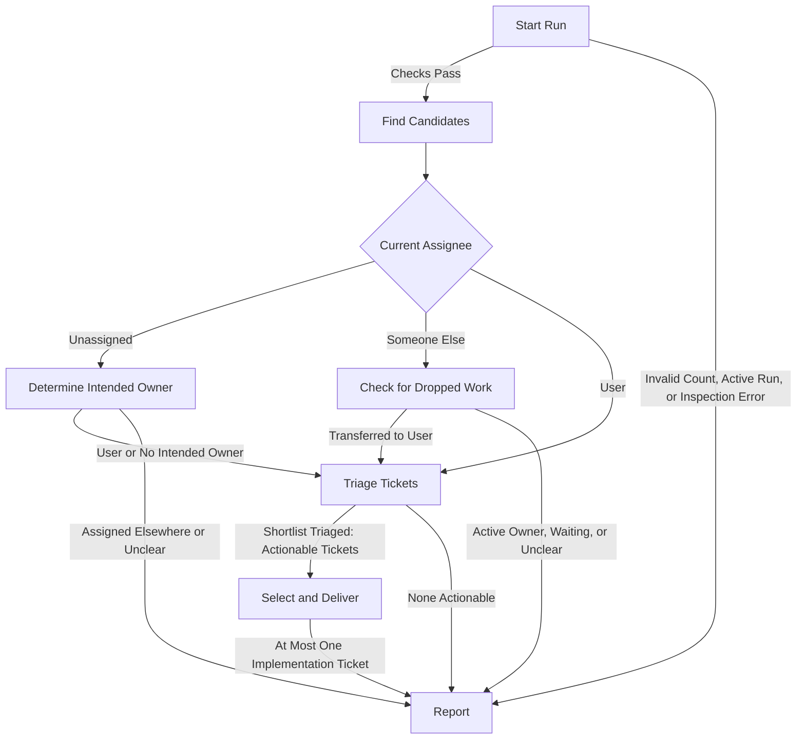

# Linear Ticket

Find work for the current user, handle staleness, and deliver one bounded outcome.
Compare actionable tickets before choosing one; report critical questions without an interview.
Triage and deliver efficiently with minimal necessary communication. Comment when participant
input is needed, ownership is redirected, or another meaningful exception warrants an update.

## Parameters

- `count=20`: Positive integer; separate per-run caps on unique tickets deeply assessed
  and unique tickets changed, shared across stages/delegates. Metadata discovery is uncapped.
- `size=m`: Maximum implementation estimate, including Review-and-clarify. Accept short/full
  names case-insensitively: XS/Extra Small, S/Small, M/Medium, L/Large, XL/Extra Large.
  Use the workflow order XS < S < M < L < XL. Larger work is triage-only.

## Flow

### Start Run

Reject invalid `count`. Before discovery, use native `list_threads` and targeted status/history
reads to check recent active chats for another ongoing `linear-ticket` invocation, regardless
of title. Exclude this run and configuration/review discussions. If another run is active,
link it and stop. Correct recoverable inspection errors and retry once; if inspection remains
unavailable or unsuccessful, report that and stop. A bounded listing
is sufficient best effort, not an atomic lock. These exits report only the reason, without
discovery, checkpoint reads, or ticket/PR writes; never interrupt the other run.

### Find Candidates

Verify the intended Linear user/account/workspace through live lookup or confirmed identity,
not OS/Git identity. Read `team`, `repository`, and the required nonempty `projectId` from
`~/.codex/private/linear-ticket-workflows.json`. Verify the project and team in the intended
workspace; stop if the project setting is missing, invalid, or cannot be verified. Normalize
`size` aliases and reject unsupported values. Use the workflow size order for selection.
Legacy `maxEstimate`/`mediumEstimateLabel` don't override `size`.

Verify team/statuses; discover tickets directly in the configured project and team with
Triage/Backlog and Todo/In Progress/In Review statuses across all assignees. Use supported
server-side filters and metadata field selection; inspect the current interface rather than
inventing arguments. Collect ID/URL, team, assignee, status, actual creator, labels, project,
priority, estimate, parent, and creation/update times. Fully paginate each query independently
and deduplicate. If a project filter is unavailable, discover sufficient team/status metadata
and verify each ticket's direct project membership. Verify current direct membership before
deep assessment and again before ticket or PR writes; inability to prove membership holds
those actions. A parent's membership does not confer membership on a child; out-of-project
parents are dependency context only, not executable work.

Reuse private checkpoints/current automation memory as caches for metadata and unassessed work.
With a trustworthy checkpoint matching the verified workspace/user/team, repository, project
identity, and query scope, prefer metadata-first updated-since deltas with a boundary overlap
and ID deduplication. Merge with prior candidates; don't drop older unassessed work. Verify
likely candidates' current eligibility and relevant context live. Reconcile tracked IDs for
closure, reopening, project and team/status moves, and reassignment. Read old out-of-project
inventory for context only: make no ticket or PR writes, and release it only from this
workflow's inventory while preserving holds, original sources, and history privately.

Use full discovery when the checkpoint is missing/untrusted, project identity or scope/filter
semantics change, or the interface cannot reliably cover new/reopened/moved-in/status changes.
Issue `updatedAt` alone cannot prove project membership or reliably detect project moves; if
available deltas cannot cover them, use full discovery. Reconcile project moves during deltas
and full scans. Repeat full discovery at least every seven days. This backstop is metadata
discovery, not unlimited assessment. Keep due reconciliation separate from delivery when the
available coverage supports a sound selection. Record scan start and advance the checkpoint no
later than that time only after all required queries are fully paginated and reconciliation is
saved. On partial/error/blocked saves, retain the previous checkpoint and unresolved inventory;
report actual scan coverage and any save failure. Absence from partial results is never closure.
Don't invent a checkpoint.

Issue `updatedAt` alone cannot detect linked PR, dependency, discussion/Slack, or human-decision
changes. Refresh relevant source activity and newly linked references separately, including
during full reconciliation; use supported metadata/deltas before rereading unchanged bodies.
When unavailable, inspect relevant sources within the assessment budget and label uncovered
work accordingly. Recheck due handoff/feedback deadlines and refresh affected live evidence
before consequential writes. Cached summaries never replace exact human approval/STOP sources.

Order assessment by human direction, native priority, impact, urgency, and meaningful
activity. Replies, due feedback, and interrupted work matter; `updatedAt` alone doesn't.
Lightly refresh unchanged holds and queued PRs. Reopen completed assessments only on relevant
new evidence; finish incomplete promising assessments. Use remaining slots for new candidates.
When shown, label inventory-only or deferred assessments Skipped with the actual reason;
new deep investigation still consumes a slot.

### Determine Intended Owner

Check current assignment, description/full discussion, linked PRs, and relevant Slack for
ticket-specific ownership evidence and later completion, withdrawal, refusal, or superseding direction.
Search ID/URL, broadening as needed. Ownership reconciliation needs reasonable evidence
that the person owns this work, independently of full relevance, completion, sizing, or
implementation-readiness investigation. Deep reads consume the assessment budget;
age or lack of a visible update alone isn't proof of inactivity or invalid ownership.

A ticket-specific human request, acknowledgement, or commitment is
  sufficient when no later evidence contradicts it or establishes completed work.
  Among owners established by that human evidence, choose the strongest-supported:
  explicit commitment, current investigation, then responsibility for the affected area. If multiple intended owners
  remain tied, choose the first named in the original human request, not an agent summary or
  generated offer. Exclude incidental mentions, reviewers, FYIs, and people who declined.
  When an intended owner is established, set and verify one assignee, then post one Linear comment; FYI-mention
  the other intended owners using verified native mentions, except the user posting it.
  Add those owners as subscribers through a supported interface, preserving existing subscribers,
  and verify the result. Mentioning alone isn't subscription proof; report unavailable or
  unverified subscription controls separately while preserving the assignment. Unresolved
  identity or applicability of the ownership evidence to this ticket blocks assignment;
  tie-breaking resolves routing, not acceptance or progress. When the ownership check finds no other intended owner, assign an eligible unassigned
  ticket to the user and verify it during triage. Preserve existing holds and write limits.
  Report ambiguous ownership separately.

### Check for Dropped Work

For other-owned tickets, use lightweight metadata to identify a plausible dropped commitment or
explicit handoff. Reconcile verified superseding handoffs first; otherwise, if the owner is
active or no takeover signal exists, stop and omit the ticket. Age, silence, or routine PR activity alone
doesn't establish dropped work. Investigate credible signals and later human handoffs without
overwriting ownership from weak inference. For a plausible takeover, confirm work remains relevant and
  inspect discussion, PRs, and project/worker activity. Post one Linear handoff offer in the
  user's voice: "Are you still working on this? I can take it if not. Unless you'd prefer to
  keep it, I'll pick it up after [date/time]." Mention the owner and set a deadline two business
  days after publication (Monday–Friday, preserving local time in America/Chicago).
  On a later normal run, after that deadline, recheck replies, assignment, and activity; only
  then assign to the user and comment on the handoff if no objection or competing activity.
  A clear earlier acceptance permits immediate handoff.
  Don't reset the window or duplicate offers. No new schedules or waiting for replies.

For assignment comments, address the assignee naturally and link the source; briefly explain
the handoff when useful. Usually one or two sentences; include constraints when they change
the recipient's next action. Keep tie-break mechanics internal unless useful to the recipient.

Never use silence to override a refusal, active PR/project ownership, or human STOP.
Ticket staleness is separate from stale ownership; don't cancel other-owned tickets.
Keep ownership evidence, original offer/deadline, next action, and ambiguity in report notes/
private checkpoints; include relevant evidence in permitted ownership comments. A missing/
unverified offer or deadline cannot justify takeover. No assignment implies a start,
deadline commitment, or implementation approval.

Retain user-owned tickets for implementation triage. Retain unresolved ownership/handoffs internally; surface consequential decisions or
passive waits under Report while independent work continues. Other-owned work isn't
executable by this workflow. Reviews on the user's PR
aren't competing ownership. Assignment changes don't override scope, size, or readiness gates.

### Triage Tickets

Compare a prioritized shortlist before selecting work. Use metadata to rank candidates and
deeply assess enough to make a sound choice, starting with likely ready user-owned tickets.
Treat `count` as a ceiling. Reserve assessment slots for required parents and a change
slot for likely implementation before discretionary writes on other tickets. Give assessed
tickets a disposition and keep unassessed inventory queued. Check relevant attachments, dependencies,
PRs, access, intended behavior, size, and verification. Finish obtainable checks that could
change selection or unblock delivery. Human-prepared work needs no prior workflow triage.
Use these dispositions.

- **Stale:** Apply the age policy, recheck, post a first-person reasoned comment, then set
  native Canceled. Distinguish stale/unprioritized from fixed; invite reopening with current
  impact/example. Verify both writes and reconcile partial failures before retrying.
- **Actionable:** Ready or safe for Review-and-clarify. Technical uncertainty may proceed
  with safe defaults, clarification questions, or a material approach-difference notice.
- **Hold.** Identify the specific requirement, prerequisite, access issue, or authorization
  that prevents safe progress. Resolve technical questions from available evidence or safe
  validation in the current run. Ask a human only for a specific input, decision, or action
  they must provide. Above `size`, propose a split or project here for approval.

Judge complete outcomes, including rollout/acceptance. Multi-phase/multi-owner work may
need project framing; a bounded approved-project leaf can qualify independently. Recheck
holds on new evidence or actionable follow-up.

#### Staleness

Investigate discussion/Slack, related fixes/tickets/PRs, and code/reproduction where practical.
Consider impact, meaningful activity, commitments, and dependencies; bot/workflow updates
don't renew demand. Agent-authored plans, questions, and keep-open statements aren't human
direction, even when posted under the user's account. Trace consequential holds to their original
human instruction; preserve genuine STOP/keep-open directions. Creation age sets disposition,
not proof of a fix:

- **Under 4 weeks (28 days):** Normal triage.
- **4 to under 12 weeks:** Lean toward cancellation for resolved, superseded, abandoned,
  or unprioritized need. Ask the user once in this chat if uncertainty could change the result.
- **12 weeks (84 days) or older:** Default to cancellation unless the bounded check finds
  meaningful persisting impact, renewed demand, active commitment, or a live dependency.
  Cite ticket-specific retention evidence and continue triage. An active project, related product
  interest, or an unanswered agent question alone is insufficient; apply the stale default once
  required ownership/relevance checks pass rather than inventing an indefinite hold.

For a participant demand-confirmation question published under existing comment authority
on an old request, allow **five calendar days from its original ticket server publication**.
User-directed demand decisions stay in chat and require an answer or explicit direction. Edits and reruns preserve the deadline;
an open window takes precedence over age-based cancellation. At expiry, recheck replies
and relevance. If demand remains unconfirmed and there is no persisting impact, active
commitment, live dependency, or explicit keep-open direction, post a brief reason, invite
reopening with current requirements, and cancel within the existing ownership rules.
Missing access or an unverifiable deadline requires investigation, not cancellation.

Unknown creation time blocks age-based cancellation; missing access/ownership isn't
cancellation evidence. Reopens/substantive replies renew assessment, not implementation
permission. Recheck eligibility/readiness; silence isn't resolution. Renewed demand or
explicit human keep-open direction prevents repeat cancellation without new evidence.

#### Approach and Size

Identify the issue, intended outcome, constraints, and evidence, including reproduction
steps when available. Investigate independently and choose the implementation best supported by
the evidence. Verify and use an estimate set or explicitly approved by the user. Independently
size implementation candidates only when they lack such an estimate. If the verified scope
exceeds the ceiling, hold implementation and preserve the user's estimate pending approval. Obtain approval for changes to approved scope or behavior.

The complete outcome must fit **`size` and one or two coherent PRs**. Don't omit essential
behavior, compatibility, permissions, or test protection to fit. Compare the applicable size directly with `size` using the workflow order. Preserve its assignee.
Above `size` is triage-only;
no automatic children or oversized parent execution. Splits/project changes need approval.

Save a new or changed estimate during triage. Verify the team’s live estimate
mapping before writing a numeric value. If the connector cannot verify it, use the native
estimate selector in the authenticated work Chrome profile. Verify the issue, team, and
saved estimate. If the write cannot be completed or verified, report the assessed size and
exact write blocker. Continue otherwise eligible implementation using the assessed size.

Before requesting split approval, investigate the complete decomposition. Each implementation
leaf needs an evidence-supported estimate within `size`, a coherent outcome, dependencies,
and acceptance/verification criteria. Cover all essential parent requirements, including
indirect compatibility effects. Larger parents may track the combined outcome; don't relabel
oversized implementation work as tracking or defer requirements to meet the ceiling.

If missing evidence prevents credible sizing, finish obtainable investigation or report the gap
before proposing children. Approved children still need execution readiness checks; tracking
approval isn't implementation approval. If later evidence changes sizing, explain the new facts
or earlier omission and propose one consolidated revision, not successive unassessed splits.

#### Verify Triage Outcomes

Before selection or reporting, check each deeply assessed ticket for a verified assignee or
exact ownership blocker, a disposition, and a concrete next action where work remains. For
implementation candidates, verify the user's estimate or independently assess and save the
size. If saving fails, follow Approach and Size. Resolve actionable gaps that affect the
choice or delivery within the current run.

### Select and Deliver

Compare the assessed set's actionable tickets by human direction, native priority, impact,
urgency, dependencies, readiness, and meaningful activity. Recommend priority-field changes;
don't silently apply them. Select **one** authorized outcome within `size`, including safe
Review-and-clarify. Verify user ownership before implementing. Resolve remaining technical
questions through code inspection and safe validation before or during implementation.
Continue until a review-ready handoff, a concrete blocker that prevents further safe progress,
or a reached limit. If no candidate qualifies, state the comparison coverage and reason.

Before implementing, trace the reported case through relevant acceptance behavior to surface
likely questions, policy conflicts, and material approach differences. Post an optional start
comment only for meaningful information to the ticket creator; required participant questions
are posted even when directed elsewhere. Combine relevant approach details and questions.
Native status records routine starts.
Ask user-directed questions/approvals in this chat. State the choice,
recommendation, and whether safe work can proceed or affected work needs an answer.
Route later discoveries and proposed follow-up comments to the user here before publishing.

For automated runs, use a suitable settled managed worktree or `create_worktree` for each
isolated checkout and give workers its verified path. When its owner settles, use
`archive_worktree` where supported, preserving needed ignored files first. Report unavailable
managed creation or cleanup; keep active, primary, shared, protected, and otherwise unarchivable
checkouts intact rather than bypassing native protection.

Follow repository isolation/authoring/testing guidance and protected-test approvals. Once
selected, a new blocker doesn't permit choosing another implementation. Preserve/reuse
existing branches/PRs; two-PR outcomes share acceptance, feedback timing, and combined validation.
Confirm plan/assignment; new work enters Todo then In Progress, while resumed work keeps
its lifecycle. Open only review-ready PRs with ticket links, behavior, approach, acceptance,
and validation. Keep work in progress on the branch.

For Review-and-clarify, publish participant questions before implementation. When safe work
is reviewable, open it ready with `noautomerge` applied at creation. If the tool cannot
create the PR with the label, keep the work on the branch and report the blocker. Verify
the label, record why it was applied, and link the PR in the comment if useful.

Remove only the clarification hold applied by this workflow, after applying substantive
feedback or a documented safe default and validating the result. The default is allowed
after **48 hours from the questions' original ticket server publication**. Edits, reruns,
and other PRs don't reset the window. User-directed questions go in this chat and require
an answer or explicit direction before releasing affected work to the queue. Chat silence
doesn't start or satisfy that window. Preserve separate holds, ownership, relevance,
prerequisites, permissions, and test requirements. Changed intended behavior, essential
scope, or unsafe unknowns still require approval before affected work.

While feedback is pending, finish authorized safe work and keep the appropriate active ticket
status. Report once safe work is complete or a limit is reached. At queue handoff, request review
under repository policy and move to In Review. Post a delivery comment only when it conveys
meaningful new information to the ticket creator; PR readiness, CI and review handoff alone
do not qualify. PR review follows the user's review workflow; never imply the creator is asked
to review unless explicitly requested. The merge queue owns eligible PRs: observe/report without
competing pushes, Draft reversions, or review/CI/merge work unless explicitly directed.
Distinguish merged, deployed, and operationally accepted.

### Report

Every run, including blocked/unchanged runs, gives one outcome sentence with meaningful
changes/delivery. Include counts, timing or coverage limits only when useful to the decision.
Then use these sections in order, placing each ticket once:

- **Needs Your Input:** Numbered decisions/interventions for currently relevant work.
  Link the ticket, recommendation and what the answer unblocks; identify the actual decision
  owner after investigation. Include proposed outreach with its audience. Retain unanswered
  consequential asks with original links; silence never resolves them. Workflow exclusions
  such as size or project scope can merit a decision here; exclusion doesn't imply low value.
- **Active Work:** A Markdown table for the user's or unassigned ready candidates,
  implementation or PR delivery, and material scope/size comparisons. Keep decision-only tickets above.
- **Waiting:** A compact list or sentence for prerequisites or handoffs that warrant attention.
  Omit unchanged blocking questions while their feedback window is open. Report replies,
  material changes, or deadline-triggered actions. Demand confirmation uses five calendar
  days; implementation clarification follows the existing 48-hour safe-default rule.
  User-directed asks still require an answer or explicit direction.

Show other-owned tickets only for assignee-flow activity: a new assignment, takeover offer,
meaningful handoff response/change, accepted transfer, or ownership decision needing input.
Omit actively owned work without qualifying assignee-flow activity or a pending ownership
decision, even if its PR changes. Apply the feedback-window reporting rule to unresolved
handoffs, preserving their original deadlines. If reporting counts, distinguish discovered,
assessed, and implementation-ready tickets.
Apply the same inclusion rules to inbox summaries. Omit inventory-only work needing no input.
Report material actions in the outcome sentence without repeating ticket details.
Sort each section by explicit human direction, priority/impact, then oldest creation
(unknown last; ID breaks ties), not by Action. Omit empty sections and routine execution receipts.

Active Work table: `Ticket | Status | Creator | Assignee | Estimate | PRs | Action | Update/notes`.
Creator: show the actual creator.
Assignee: show the current Linear assignee's name without a qualifier. If unassigned but
context establishes an intended or suggested owner, show `Name (inferred from Slack)` or
`Name (inferred from Linear)` only with a concrete ownership/write blocker or exhausted
change budget stated in notes. Otherwise complete the supported assignment before reporting;
apply the ownership tie-break rather than retaining alternatives. Readiness or subscription
uncertainty alone doesn't justify leaving a supported owner inferred.
An explicit commitment outside the assignee field still uses the inferred-source qualifier.
Otherwise show `Unassigned`, or `unknown` if the field/evidence wasn't verified. Don't add
an Unassigned prefix or separate commitment labels; reporting an owner doesn't assign the ticket.
Link tickets/PR states/evidence. Action is this run's work:
observed merges are Assessed; inventory-only or deferred assessments are Skipped.
Notes explain why the ticket is included when unclear, what was checked/changed, and its
disposition or next action. For Skipped, give the specific reason. If a limit was reached,
name the limit and the operation it prevented. The assessment cap does not stop checks on
already-counted tickets, and the change cap does not stop read-only investigation.
Skipped work remains pending where checks are unfinished. An assignee alone doesn't establish activity or staleness.
Use unknown for unverified facts, — for verified none.
Keep the full internal inventory until verified closure, project-scope exclusion or explicit
tracking release; report omission and reassignment aren't release. Retain unresolved holds,
offers/deadlines and incomplete checks privately; label carried-forward findings when shown.
Do not collect closed/other-owner inventories solely for reporting. Surfacing excluded work
as a decision or dependency grants no eligibility exception or execution authority.

Finish after reporting and applying the [Completion Check](#completion-check) when applicable. Skip interviews and waiting for replies. Later answers update the
relevant disposition within remaining authority/budget; they don't restart discovery,
replenish budgets, or permit a second implementation. Don't revive completed/withdrawn proposals.

## Completion Check

Before ending the turn, check your work against these criteria.

- **Done**
  - Verify the shortlist comparison and readiness of any selected ticket.
  - Apply the sizing and estimate verification rules.
  - Verify the review-ready handoff, the blocker or reached limit, or why no candidate qualified.
- **Great**
  - Back the selection and dispositions with evidence.
  - For each gap, name the blocker or limit, next action, and owner.
  - Keep investigation with the automation. Ask people only for facts or decisions they can provide.

If a material gap still has a feasible next step, take it and recheck. Honor existing limits, retries, hard stops, and write safeguards. Keep the selected ticket and respect merge queue ownership.

Retry up to 2 times.

## Rules

- Leave ticket descriptions unchanged unless the user explicitly requests a specific edit.
  Use permitted comments for participant-facing updates; put implementation decisions and
  validation details in the PR. Keep Codex chat links, approval provenance, and workflow
  bookkeeping in chat or private checkpoints, not Linear.
- Honor read-only/report-only limits. Normal runs authorize Linear assessment/updates,
  eligible stale cancellations, and one ticket's implementation/commits/pushes/PR
  handoff. Exclude merging, auto-merge, deployment, production writes, project creation/
  reorganization, email/SMS/Slack messages,
  and automation changes. Readiness/silence isn't
  authorization; follow applicable approvals.
- `count` limits assessed tickets and, separately, changed tickets—not API calls. Count
  each deeply read ticket once across ownership/triage/delegates, including holds and parents.
  Metadata-only refreshes consume no assessment slots. Delegate briefs include remaining budgets, `size`, and expected
  readiness/relevance/disposition. Critical questions/approval needs have no separate cap.
- Verify the repository remote before code access. Reuse sufficient evidence; refresh affected
  ownership/discussion/prerequisites/PRs before writes. Missing evidence blocks dependent
  actions, not independent work; report incomplete coverage, never false emptiness.
- STOP holds require fresh resumption direction. Only the explicit handoff process above
  authorizes reassignment after silence; silence never approves implementation or scope changes.
  Completed approvals aren't standing instructions/eligibility exceptions. Don't duplicate external outreach/reminders, invent
  questions, or promise background follow-up.
- Messages intended for the user belong in this chat, including approval requests.
  Otherwise, ticket comments are limited to ownership assignments/handoffs and takeover
  offers/completion; stale cancellation reasons and reopening invitations; the first
  implementation update with the approach and known participant questions; and ready delivery.
  Apply creator relevance to optional start and ready-delivery comments as specified above;
  required participant questions remain mandatory. Add a useful later PR link by editing
  the initial implementation comment when one exists. Route other
  proposed comments to the user here and await explicit instruction before publishing.
  Speak on the user's behalf in their voice, naturally and conversationally, following the
  [canonical writing guide](../../agents/writer.md#guide-location). Keep internal dialogue
  between the user and the agent out of ticket comments.
  State the user's decisions directly as their own; mention approval or feedback only when
  requesting it from another person. Keep the user's approvals and provenance in chat or
  private checkpoints.
  Keep comments within 100 words, lead with important requests in bold, and address recipients
  using verified native mentions: `@person: question`. Consolidate related information into
  the applicable comment; technical detail belongs in specifications/PRs.
- Keep settings/checkpoints private. Checkpoints at
  `~/.codex/private/linear-ticket-workflow-state/<verified-issue-uuid>.json` are caches, not
  authority (directory 0700/files 0600). Preserve sources, approval scope/completion,
  questions/decisions, original feedback time, next action, inventory/closures, and assessed
  versus applied feedback. Recover stale/missing state from live sources; no private
  bookkeeping in tickets/PRs/repo trackers.
- For automation runs, replace superseded memory with one concise current-state note:
  scope, discovery/full-discovery checkpoints, coverage gaps, open-work/checkpoint links,
  holds/deadlines/decisions, and next actions. Keep detailed history retrievable in native
  chat/ticket/PR records or private checkpoints; before removing its only copy, preserve a
  private historical record and reference. Keep the full tracked/unassessed inventory and
  exact approval/STOP provenance recoverable. Memory never proves eligibility or clears a hold.
- Memory/checkpoint saves never block reporting/questions. If blocked, briefly explain,
  retain results in chat, and complete the report. Don't substitute memory approval,
  wait, or bypass the restriction; recover later from chat/live evidence. No grill-me session.
