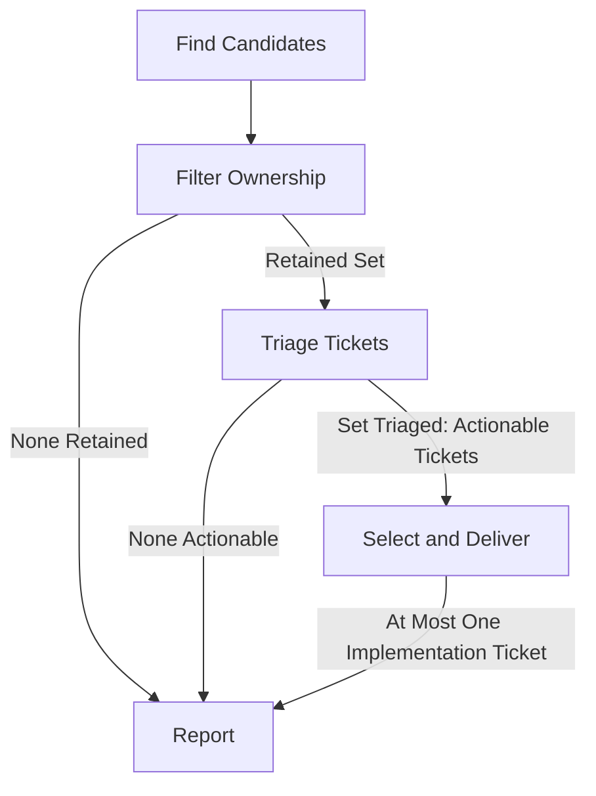

# Linear Ticket

Find work for the current user, handle staleness, and deliver one bounded outcome.
Compare actionable tickets before choosing one; report critical questions without an interview.

## Parameters

- `count=20`: Positive integer; separate per-run caps on unique tickets deeply assessed
  and unique tickets changed, shared across stages/delegates. Metadata discovery is uncapped.
- `size=m`: Maximum implementation estimate, including Draft-and-clarify. Accept short/full
  names case-insensitively: XS/Extra Small, S/Small, M/Medium, L/Large, XL/Extra Large.
  Resolve to the team's live estimate option and numeric value; larger work is triage-only.

## Flow

### Find Candidates

Reject invalid `count` before discovery. Verify the intended Linear user/account/workspace
through live lookup or confirmed identity, not OS/Git identity. Read `team` and `repository`
from `~/.codex/private/linear-ticket-workflows.json`. Before assessment/writes, normalize
`size` aliases and resolve the live estimate option/order/value; reject unsupported or
ambiguous mappings. Use numeric Linear values, not hardcoded M=3 or alphabetical comparisons.
Legacy `maxEstimate`/`mediumEstimateLabel` don't override `size`.

Verify team/statuses; list configured-team Triage/Backlog and Todo/In Progress/In Review tickets assigned to the
user or unassigned. Collect ID/URL, assignee, status, creator, priority, estimate, parent, and
creation/update times; paginate independently and deduplicate. Ignore creator filters.
Recover tracked work from history/checkpoints and live ticket/PR evidence, including
changed statuses/assignees; recovery doesn't confer eligibility.

Order assessment by human direction, native priority, impact, urgency, and meaningful
activity. Replies, due feedback, and interrupted work matter; `updatedAt` alone doesn't.
Lightly refresh unchanged holds and queued PRs. Reopen completed assessments only on relevant
new evidence; finish incomplete promising assessments. Use remaining slots for new candidates.
Label inventory-only checks Not assessed; new deep investigation still consumes a slot.

### Filter Ownership

Check assignment, description, full discussion, linked PR activity, and relevant Slack
threads before triage writes. Search ticket ID/URL, broadening to issue terms as needed.
Deep ownership reads use the assessment budget; don't investigate the entire inventory
or treat unread ownership as clear. Retain:

- **Assigned to the current user:** Creator is irrelevant. Assignment supersedes older
  routing requests; coordinate genuinely active competing work before writes/building.
- **Unassigned with no intended assignee:** Named requests, handoffs, or actual investigation/
  implementation establish intended ownership, even before a response. If directed to
  anyone, wait for assignment. Silence, age, or generic "anyone can pick it up" don't erase it.

Skip other-owned or consequentially ambiguous work unchanged; report intended versus
confirmed ownership and urgent gaps. FYIs, incidental mentions, expertise, advice/review
requests, and tracking links alone aren't implementation ownership. Reviews on the user's
own PR aren't competing ownership. Historical manual fulfillment or implementation doesn't
assign a distinct follow-up request; establish ownership of the current outcome. No takeover
timers/offers or other-owned cancellations.

### Triage Tickets

Build and triage the bounded set incrementally, reserving slots for required parents
before admitting more candidates. Give every retained ticket a disposition or documented
assessment limitation **before selection**; don't build the first actionable ticket found.
Read relevant attachments, relations, and PR evidence. Resolve current relevance/priority
before scope/implementation details; then check context/access, essential behavior,
dependencies/permission, independent size, acceptance criteria, and verification.
Finish obtainable readiness checks for counted tickets; the unique-ticket cap limits admitting
additional tickets, not inspection of those already counted. Human-prepared work needs no prior
workflow triage. Dispositions:

- **Stale:** Apply the age policy, recheck, post a first-person reasoned comment, then set
  native Canceled. Distinguish stale/unprioritized from fixed; invite reopening with current
  impact/example. Verify both writes and reconcile partial failures before retrying.
- **Actionable:** Ready or safe for Draft-and-clarify. Technical uncertainty may proceed
  with safe defaults, clarification questions, or a material approach-difference notice.
- **Hold:** Unresolved intended behavior/essential scope, unsafe unknowns, ownership,
  dependencies, access, or
  permission block affected work. Investigate obtainable facts; otherwise report blocker,
  owner, resumption condition, and critical user questions. Don't claim held work. Ask other
  parties on the ticket only when authorized/useful. Above `size`, recommend a split/project
  and report needed approval.

Judge complete outcomes, including rollout/acceptance. Multi-phase/multi-owner work may
need project framing; a bounded approved-project leaf can qualify independently. Recheck
holds on new evidence or actionable follow-up.

#### Staleness

Investigate discussion/Slack, related fixes/tickets/PRs, and code/reproduction where practical.
Consider impact, meaningful activity, commitments, and dependencies; bot/workflow updates
don't renew demand. Agent-authored plans, questions, and keep-open statements aren't human
direction, even when posted under the user's account. Trace consequential holds to their original
human instruction; preserve genuine STOP/keep-open directions. Creation age sets disposition,
not proof of a fix:

- **Under 4 weeks (28 days):** Normal triage.
- **4 to under 12 weeks:** Lean toward cancellation for resolved, superseded, abandoned,
  or unprioritized need. Ask once if specific uncertainty could change the result.
- **12 weeks (84 days) or older:** Default to cancellation unless the bounded check finds
  meaningful persisting impact, renewed demand, active commitment, or a live dependency.
  Cite ticket-specific retention evidence and continue triage. An active project, related product
  interest, or an unanswered agent question alone is insufficient; apply the stale default once
  required ownership/relevance checks pass rather than inventing an indefinite hold.

Unknown creation time blocks age-based cancellation; missing access/ownership isn't
cancellation evidence. Reopens/substantive replies renew assessment, not implementation
permission. Recheck eligibility/readiness; silence isn't resolution. Renewed demand or
explicit human keep-open direction prevents repeat cancellation without new evidence.

#### Approach and Size

For bugs, extract observations, expected behavior, reproduction facts, and constraints;
investigate independently before comparing implementation suggestions/estimates. For
requests, preserve the outcome while independently choosing implementation/size.

The complete outcome must fit **`size` and one or two coherent PRs**. Don't omit essential
behavior, compatibility, permissions, or test protection to fit. Update estimates from
evidence without claiming oversized work or removing its assignee. Above `size` is triage-only;
no automatic children or oversized parent execution. Splits/project changes need approval;
approved children need their own readiness checks. Tracking approval isn't implementation approval.

### Select and Deliver

Compare the assessed set's actionable tickets by human direction, native priority, impact,
urgency, dependencies, readiness, and meaningful activity. Recommend priority-field changes;
don't silently apply them. Select **one** authorized outcome within `size`, including safe
Draft-and-clarify; leave others queued without invented blockers. Incomplete assessment
isn't readiness. If none qualify, report instead of forcing a build.

Follow repository isolation/authoring/testing guidance and protected-test approvals. Once
selected, a new blocker doesn't permit choosing another implementation. Preserve/reuse
existing branches/PRs; two-PR outcomes share acceptance, feedback timing, and combined validation.
Confirm plan/assignment; new work enters Todo then In Progress, while resumed work keeps
its lifecycle. Create Draft PRs with ticket links, behavior, approach, acceptance, and validation.

For Draft-and-clarify, post the implementation question or material approach difference
with rationale and Draft PR link. Keep affected PRs Draft until substantive feedback is
applied or **48 hours from original server publication** expire and documented safe defaults
are used. Edits, reruns, and other PRs don't reset the window. Changed intended behavior/
essential scope or unsafe unknowns still need approval before affected work; time never bypasses
human Draft holds, ownership, relevance, prerequisites, permission, or tests.

While feedback is pending, keep Draft/appropriate active ticket status and report without
waiting. Once gates clear, recheck answers/validation and resolve in-scope feedback. Without
a feedback wait, verified complete work can be ready. Only on ready handoff, request review
under repository policy, move to In Review, and post one delivery comment linking PRs,
verification, and remaining steps. The merge queue owns ready PRs: observe/report without
competing pushes, Draft reversions, or review/CI/merge work unless explicitly directed.
Distinguish merged, deployed, and operationally accepted.

### Report

Every run, including blocked/unchanged runs, reports:

- One outcome sentence: screened/changed/build, still-in-play count, and coverage limits;
  timing once if useful, plus at most three result/intervention bullets.
- **Critical Questions:** Only user decisions that unlock currently relevant work, resolve a
  consequential disposition, or address a current risk. Link the ticket, consequence, and
  recommendation. Investigate first and identify the actual decision owner; another person's
  routine follow-up isn't automatically a user question. Keep parked prerequisites and
  speculative product questions in table notes. Repeat unanswered questions only while still
  consequential, labeled already asked with original links; never treat nonresponse as demand.
- **Still in Play:** Every tracked open ticket for the user or unresolved ownership, including holds.

Still in Play table: `Ticket | Status | Creator | Estimate | PRs | Action | Update/notes`.
Sort Action alphabetically with Not assessed last, then native status order and oldest creation
(unknown last; ID breaks ties). Link tickets/PR states/evidence. Action is this run's work:
observed merges are Assessed; inventory-only is Not assessed. Notes give disposition
and next owner/action. Use unknown for unverified facts, — for verified none.
Keep tracked work until verified closure or explicit tracking release; reassignment isn't
release. Label carried-forward findings/incomplete recovery. Unrelated candidates aren't
permanent watchlists. Do not collect closed-ticket or other-owner inventories solely for
reporting; mention material outcomes or ownership blockers in the summary when useful.
Omit empty sections; shorten prose, not required inventory.

Finish after reporting: no interview or waiting for replies. Later answers update the
relevant disposition within remaining authority/budget; they don't restart discovery,
replenish budgets, or permit a second implementation. Don't revive completed/withdrawn proposals.

## Rules

- Honor read-only/report-only limits. Normal runs authorize Linear assessment/updates,
  eligible stale cancellations, and one ticket's implementation/commits/pushes/Draft/ready
  handoff. Exclude merging, auto-merge, deployment, production writes, project creation/
  reorganization, email/SMS/Slack messages, and automation changes. Readiness/silence isn't
  authorization; follow applicable approvals.
- `count` limits assessed tickets and, separately, changed tickets—not API calls. Count
  each deeply read ticket once across ownership/triage/delegates, including holds and parents.
  Metadata-only refreshes consume no assessment slots. Delegate briefs include remaining budgets, `size`, and expected
  readiness/relevance/disposition. Critical questions/approval needs have no separate cap.
- Verify the repository remote before code access. Reuse sufficient evidence; refresh affected
  ownership/discussion/prerequisites/PRs before writes. Missing evidence blocks dependent
  actions, not independent work; report incomplete coverage, never false emptiness.
- STOP holds require fresh resumption direction. Completed approvals aren't standing
  instructions/eligibility exceptions. Don't duplicate external outreach/reminders, invent
  questions, or promise background follow-up.
- Use the user's voice and [canonical writing guide](../../agents/writer.md#guide-location).
  Comments: outcome/needed response, next action, at most 100 words. Once decisions settle,
  publish one cohesive plan covering action, rationale, needed input, and verification.
  Reuse plans and preserve approval/discussion evidence; don't post each partial answer.
  Significant questions, blockers, and delivery results may merit separate comments;
  technical detail belongs in specifications/PRs, not workflow receipts/interview provenance.
- Keep settings/checkpoints private. Checkpoints at
  `~/.codex/private/linear-ticket-workflow-state/<verified-issue-uuid>.json` are caches, not
  authority (directory 0700/files 0600). Preserve sources, approval scope/completion,
  questions/decisions, original feedback time, next action, inventory/closures, and assessed
  versus applied feedback. Recover stale/missing state from live sources; no private
  bookkeeping in tickets/PRs/repo trackers.
- Memory/checkpoint saves never block reporting/questions. If blocked, briefly explain,
  retain results in chat, and complete the report. Don't substitute memory approval,
  wait, or bypass the restriction; recover later from chat/live evidence. No grill-me session.
