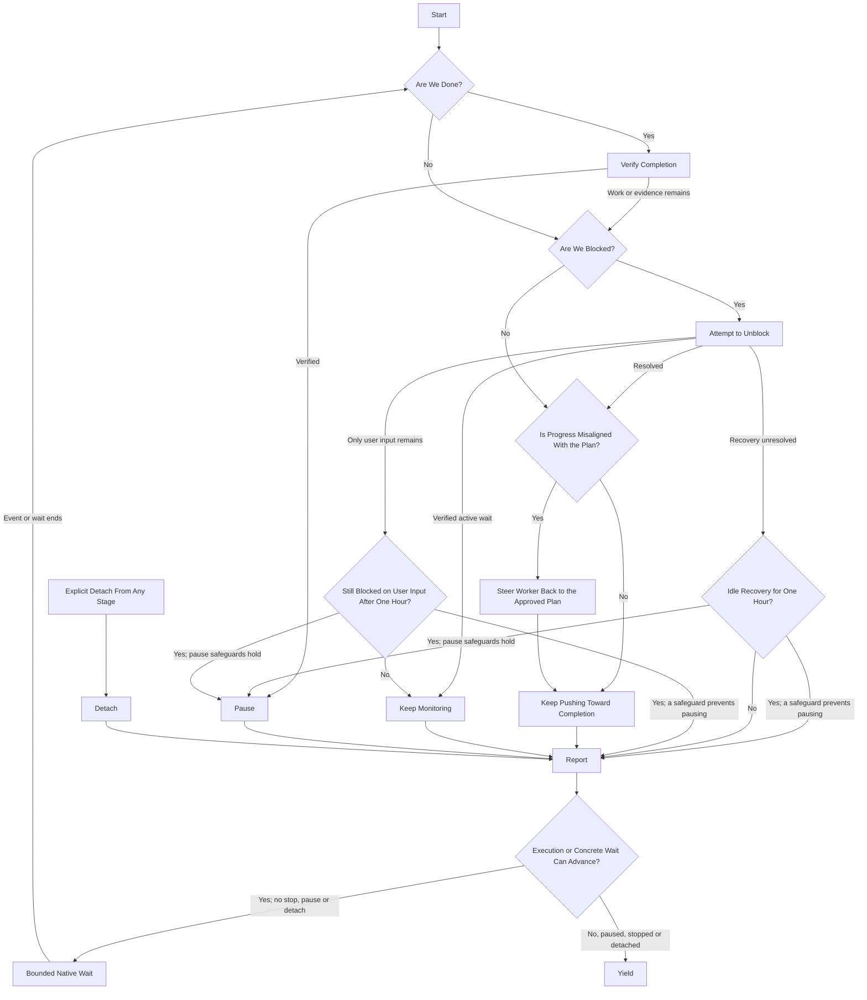

# Project Supervision

Keep approved work moving toward the project's outcome while this supervisor chat
stays available for the user's decisions and steering. Delegate lengthy discovery,
preparation and implementation to reusable worker subagents. Stay active while useful
execution or a concrete pending event can advance; ordinary messages and steering do
not implicitly stop work or request detach.

## Flow

Start is one invocation by the user or the existing automation. Explicit stop
instructions override the flow immediately. Detach from any stage follows Detach;
it ends only the supervisor turn.



### Start

- A human invocation adopts this supervisor chat and authorizes ordinary setup,
  worker selection and scoped dispatch/steering. Resolve project, repository and
  user direction; clarify ambiguity. Stale ticks cannot adopt supervision or
  resume paused/stopped work.
- Once project execution is authorized, keep advancing that approved scope while
  supervision is active. Batch completion does not expire execution authority.
  An already-paused supervisor schedule requires user direction to resume under Pause;
  existing stop, monitoring and self-pause rules still apply.
- Apply stops before audits or Linear access. A project stop ceases dispatch and
  covers every owned worker/helper unless lane-scoped. Stop affected execution and
  pause the heartbeat through supported controls; inspect and report running/unknown
  work. Pausing does not prove settlement.
- Otherwise recover contract, tickets, PRs and roster from this chat/current sources.
  Reconcile recorded subagent IDs using native status, messages/results and targeted history
  before dispatch, including after a heartbeat or user message. Inspect active or uncertain assignments.
  Once the final report is captured and owned commands/helpers/writes are verified
  settled, retain the roster entry without routine polling. Recheck before reuse or
  on new activity, contradictory evidence or recovery need. Capture pending escalations before
  reusing an agent; keep them until actually resolved. Resolve missing reports
  and uncertain ownership before overlap. Attempt authorized unblocks for each blocked or
  stalled lane and prepare exact human requests even while others progress. Global
  blockage controls project-wide waiting/pausing, not attention to individual lanes.
- Establish readiness through [project-audit](../project-audit/SKILL.md) before
  activation/resume, worker creation or dispatch. Reuse completed applicable coverage
  under one hour old if current Linear/PR deltas support it; refresh at one hour or
  after an earlier consequential change. Chat silence is insufficient. Record completion time,
  verdict and coverage. Failed/incomplete coverage holds affected new dispatch without
  refreshing its timestamp; completed coverage may support independent ready work.
  Age or failed refresh alone does not interrupt still-supported active work.
  Between due audits, refresh records relevant to active work, dependencies, pending
  decisions and dispatch. Reuse still-supported contract evidence; supported change
  indicators or uncertainty determine expanded reads, not chat silence.
  For lengthy cold-start audits, complete limited readiness for read-only audit or
  preparation: verify target, authority, ownership, deliverable and supported isolated
  setup before creation, actual worktree before repository dispatch. Delegate only
  that scope; implementation needs its own completed current assessment. Limited
  preparation coverage neither verifies broader readiness nor refreshes a full audit.
- Assess apparent completion against approved criteria. A finished batch, Done status
  or merged PR is insufficient. Challenge completion when warranted, not every tick.

Create, activate or resume the supervisor heartbeat only for eligible execution, scoped
preparation,
verified active waits or the first-hour user-input/idle-recovery grace periods. Reuse the supervisor heartbeat:
nominally every 15 minutes, `kind=heartbeat`, exact prompt `$project-supervise`, bound to
this chat; workers have no automation. Completion needs no new automation. Grace periods
permit monitoring, not unready execution. Run the first cycle immediately.
Verify binding/state, preserve
partial setup and inspect uncertain results before retrying. Pause known superseded
heartbeats without exhaustive history searches; stale ticks cannot reclaim ownership.

### Verify Completion

1. Map approved goals/phase exits to evidence. Inspect the combined merged revision,
   affected consumers, interfaces, runtime/configuration and maintained instructions.
   For removals, check obsolete reachable behavior/instructions; legitimate history
   may remain.
2. Have an authorized non-author independently seek counterexamples in primary evidence. The
   supervisor qualifies if independent of authoring; otherwise use an authorized
   assessor within existing limits. Challenge the combined outcome, not every PR.
3. Verify consequential corrections. Disposition findings: corrected, retained with
   purpose/authority, outside scope with rationale, or unresolved/unverified.
   Required gaps prevent completion; missing scope/protected changes need the user's
   exact decision. Reuse valid challenge evidence until material changes or contradictions
   invalidate it.
4. Preserve required deployment, operational proof and designated human acceptance.
   Once satisfied, pause and Report criteria evidence, revision, assessor/coverage,
   findings and remaining nonblocking obligations. Otherwise route remaining gaps
   through the flow.

This adds no blanket acceptance gate or Linear authority. Summarize here without
an automatic publication question. If reported completion proves false, identify
reconciliation/reopening; change records only with scoped user authority.

### Attempt to Unblock

- The project is blocked only when no useful independent work can proceed. Test early-stop
  claims against the next plausible approved ticket. Distinguish required merged or deployed
  behavior from prerequisite source permitting authoring under stacking rules.
- Resolve routine blockers within authority. Delegate substantial approved discovery or
  read-only preparation; it authorizes no dependent implementation or amendment.
  Hold affected paths while independent ready work continues.
- For user-only blockers, present the actionable request in Report and retain its
  first timestamp for the one-hour wait. Unfinished agent preparation is not a user approval
  request. Relay the user's actual answer to the same worker with its request context;
  verify the handoff before treating affected work as resumed. Continue independent work.
- Monitor identified active owners/processes or concrete pending events. An assignee
  or Todo/Backlog status alone establishes no active wait.
- When bounded recovery is exhausted without useful human intervention or a credible
  active wait, report the recovery owner/action and uncertainty. Start the idle clock
  only when no useful authorized work can proceed and no owned execution is running
  or unknown. Follow the grace and Pause rules; never invent a wait or approval ask.

### Steer Worker Back to the Approved Plan

Compare actual progress and artifacts with ticket criteria and project contract. Send
in-scope draft corrections through supported messaging, inspect their evidence and retain
the original deadline.
After readiness, report issues for the queue or user to handle without competing changes.
Keep necessary amendments as proposals in Report with reasoning, impact and exact
approval requested; continue independent work.

### Keep Pushing Toward Completion

- Use up to three concurrent assignments when approved work can progress independently.
  Choose concurrency by dependencies, ownership, collision risk and available capacity;
  preserve explicit user limits. Each writing assignment needs its own verified worktree
  and clear ownership. Serialize conflicts; active/unknown execution occupies capacity
  until verified settled. Higher caps require user approval. Reductions drain batches
  unless interruption is requested. Fill eligible idle slots without repeated permission.
- Assign distinct ordered shortlists, normally five tickets, exceeding expected
  batch capacity when available. Respect priorities, dependencies, ownership and
  milestone review gates. Refresh shortlists and dispatch successive batches within
  standing execution authority without renewed permission. Obtain still-required
  plan/execution approvals; phase completion neither expands authority nor creates
  a new approval gate within already-authorized scope.
- Check entire shortlists for collisions: shared semantic/test regions, queue-owned
  pending changes and runtime resources. Barrels, generated metadata, mocks and
  fixtures need one owner or serialized edits. Separate worktrees alone do not prove
  independence. Hold only collisions.
- Before declaring work blocked by a prerequisite, identify exactly what needs it to land.
  Check for independent authoring, a justified stack with verified ancestry, or bounded
  preparation or validation. Dispatch what can proceed under existing authority; for work
  that must wait, record the blocker, its owner, and the next event to check.
- For future implementation assignments, prefer [coding-low](../../agents/coding-low.toml)
  for prescribed edits, codemods and deterministic regeneration; [coding-medium](../../agents/coding-medium.toml)
  for bounded judgment within established contracts; and [coding-high](../../agents/coding-high.toml)
  for ambiguous contracts, difficult diagnosis, concurrency, migrations or recovery. Select
  directly; no lower-tier attempt is required, and diff size alone does not determine the tier.
  Generic delegates and explorers remain available for noncoding work; dedicated PR specialists
  retain their roles. Agent descriptions are the routing authority.
- Bind roster slots to stable subagent IDs and the verified parent/supervisor chat identity.
  Use `spawn_agent` with `fork_turns="none"` and a compact assignment; reuse a settled worker
  with `followup_task` when its role fits, and steer with `send_message`. At a safe completed
  assignment boundary, if another role is warranted, settle helpers and verify the worktree and
  PR handoff, preserving ownership and partial work before selecting a fresh worker. Do not
  interrupt or reconfigure active workers or change current assignments for this routing.
  Inspect recorded agents before spawning; a completed turn may mean blocked, not completed work.
  Missing IDs, reports or uncertain execution require recovery before replacement or overlapping dispatch.
- Verify a dedicated managed Git worktree for each repository execution slot. Reuse a
  suitable settled checkout or create one through supported `create_worktree` controls
  from the verified repository/ref; pass its absolute path to the subagent and verify
  checkout/ownership before edits. Subagents share the parent's default directory:
  spawning alone provides no isolation. Preserve partial setup and uncertain writes.
- Read [the worker contract](references/worker.md) and assignment checklist before
  first assignment; reuse current context unless changed/uncertain. Every assignment
  supplies its resolved absolute path and explicitly directs the worker to read and follow it.
  Batches normally last 50 minutes including cleanup/reporting. Refresh exhausted or
  materially changed shortlists.
- Verify the Start heartbeat and dispatch state. While work or a concrete event can
  advance, stay attached using bounded, interruptible native waits across workers where
  supported. A timeout alone calls for another wait, not fresh service reads, worker
  messages or commentary. Check when a required check is due, execution may be stalled,
  evidence conflicts or a decision needs it; preserve deadline and readiness checks.
  Send workers concrete steering or questions when needed; request status only when
  current evidence is insufficient. Process actionable messages promptly.
  Ordinary steering changes only its stated scope; preserve unaffected execution/deadlines.
  Prepare the next handoff and dispatch useful work without routine batch approvals.
  Before ending any turn, including a heartbeat or a reply to the user, reconcile worker
  results and refill eligible settled slots. If workers are active or uncertain, or approved
  work or a concrete wait can advance, return to bounded native waits and repeat the loop.
  Posting a report, dispatching a worker, or asking a question does not end supervision while
  independent work can proceed. Yield only on explicit detach, stop or pause, verified
  completion, or when no useful execution or credible wait remains.
  Runtime subagent capacity is separate from the approved project assignment cap.

Off hours, the user authorizes a separate queue chat when project-ready PRs have
materially new actionable work or a verified unblock. Resolve the repository's saved,
user-approved queue automation and current bounded invocation; use its timezone/window
and parameters, not remembered defaults. If authority or target is unclear, report it.
This is the normal repository-wide queue, including the user's other eligible PRs.
Respect current user queue stops and scoped holds; a fresh chat resets no authority.

Before launch, inspect recent native chats for an active same-repository queue run;
link/monitor it rather than adding another prompt. Resolve inspection errors or hold.
Otherwise verify the saved project is a Git repository and use `create_thread` with
that project ID and `environment: {type: "worktree"}` for a separate queue chat carrying
the approved invocation. Require verified repository/worktree isolation before work.
Retain all queue risk/review/ownership/merge safeguards.
Record the returned ID and triggering PR revisions/result here; reconcile uncertain
creation before retrying. Admission is best effort, not an atomic lock. Do not
relaunch unchanged held work each tick, commandeer project workers, or change the
queue automation, schedule or limits. The queue remains responsible for its pipeline.

### Keep Monitoring

Start each user-only blocker's clock at its first actionable Report request; recover
that timestamp later. Monitor until unresolved for over one hour. Repeats, partial
or unrelated answers do not reset unresolved asks; sufficient answers resolve them.
Continue independent work and verified active waits regardless of this timer.

For nonhuman recovery, retain the first report establishing exhausted bounded
recovery and continuous idleness. Repeated checks, failures or rewritten reports do
not reset it. Useful work, a credible active wait, or running/unknown owned execution
ends idle eligibility; start a new idle period only when those conditions clear.

Monitor verified processes that can unblock work; investigate stalls. Do not pause solely
because checks remain unchanged. Monitoring handoffs need an identified owner and
verified supported resolution-detection mechanism.

Worker completion/escalation is not guaranteed to wake an idle supervisor. After yielding,
retrieve pending results on the next heartbeat or relevant user turn; status requests use
current evidence. Busy coordination can process incoming worker messages directly.
If no useful execution or credible event can advance, Report and yield while the heartbeat
monitors any remaining grace period; do not stay busy merely waiting for a human answer.

### Detach

On an explicit user instruction to detach, finish or reconcile the current supervisor
operation, capture agent IDs/status, assignments, deadlines and pending requests, then
briefly Report and end the turn without waiting for workers to finish. Leave work/subagents,
scope, deadlines, timers and the existing heartbeat unchanged. This is neither stop nor
pause and does not require worker settlement. A pending parent tool may delay yielding;
detach is an instruction convention, not a native client command. Detach applies only
to the current turn and expires when it ends; never carry it forward as a persistent mode.
Each later user turn or heartbeat resumes busy coordination under existing authority
unless stopped/paused. After reporting, continue bounded waits while useful execution or
a credible event can advance; a heartbeat report alone is not a reason to yield.

### Pause

Pause and verify the heartbeat after verified completion or an explicit project
stop (immediate), or after over one hour of user-only blockage or exhausted nonhuman
idle recovery. Automatic idle pausing requires no useful work can proceed, no credible
active wait and no running/unknown owned execution. Preserve every outstanding human
request's full one-hour response window. Unknown status is not evidence of idleness.
Explicit stops still apply immediately, with unsettled execution disclosed.

Record the reason, recovery owner/action and resume condition. A sufficient answer
from the human resolving the blocker counts as direction to resume blocker-paused
supervision once ready. Other pauses and explicit stops require later human
resume/invocation; stale ticks cannot resume supervision. Pausing ends automatic
recovery checks: explain that the user must return here or authorize a supported
wakeup/answer relay. A written condition provides no wakeup; do not silently create
another monitor.

### Report

During execution, report only actionable blockers/escalations and completion; routine
progress stays quiet. Escalate threats to scope, approach, correctness or deadlines,
ownership collisions and unexpected execution state. Answer user status requests from
current evidence. Worker silence alone proves neither a stall nor completion. Finish
with a self-contained report on detach, completion, stop/pause or no useful execution/wait,
including blocked or unverifiable state. Distinguish authored, merged, deployed and accepted
work. Retain unresolved requests until evidence resolves them; uncertainty stays unknown.
Progress reports alone do not require yielding while useful coordination continues.

```markdown
### Summary

[Two to four concise sentences: progress, plan alignment, execution assessment,
and a grounded improvement recommendation or why no change is warranted.]

### Planning Proposals

- **PLAN CHANGE PROPOSAL — [Change]:** [Current plan → exact amendment; reasoning;
  material delivery/validation impact; exact user approval requested; affected links.]

### Blockers

- [Human decision, permission or intervention; recommendation, affected work and
  what the answer unblocks. For user-only waits, include first-request time and
  the next check or pause state. Refer to a planning proposal by name.]

### Next Steps

- [Owner — next authorized action/result, or wait and resume condition.]

### Other

- [Material outcome/risk, evidence/validation limits, recovery or control details.]
```

Keep Summary, Blockers (**None** if empty) and Next Steps; omit empty optional sections.
Questions need reasoning/impact; amendment approvals must say **PLAN CHANGE** and name
the amendment. Operational permissions belong in Blockers unless amending the plan.
Keep unapproved proposals separate from execution commitments. Agent/queue problems and
routine merge/risk
holds are not human blockers: own resolution in Next Steps or explain delivery impact in Other.
Report only grounded concerns and recommendations.

Retain the full report in the supported heartbeat response, respecting its quiet
envelope and saved notification preferences. Notify only on actionable blockers/escalations
or completion; retain unchanged asks without redundant notifications.
Disclose unavailable delivery/missing output. Interruption may prevent reporting;
inspect unknown execution next cycle rather than claiming settlement.

## Rules

- The user owns the plan. Follow the [plan and state permissions](../project-audit/references/project-contract.md#plan-and-state-permissions)
  and [supervised Linear write gate](../../AGENTS.md#linear-writes-during-supervised-implementation).
  Generic supervision grants no manual ticket/project edits, comments or posts.
  Relay actual user authority with its source and scope; reuse exact approvals.
  Verify authorized writes and recover uncertain outcomes before retrying.
- Follow [PR ownership](../../AGENTS.md#pr-delivery-ownership-in-project-workflows):
  workers author/validate/ready drafts; the queue owns ready PRs. The supervisor
  steers and evaluates alignment without editing PRs or taking over their pipeline.
- Execution stays within approved tickets and scoped preparation. Missing scope
  needs a proposal. Deployment, production mutations, operational acceptance,
  explicit-only skills and external communications retain their owning permissions.
  Authorized project posts follow the [status update policy](../../AGENTS.md#project-status-updates).
- Use actual supported tools and controls. A denial is not an invitation to change
  transports. For an authorization rejection, retrieve the existing human approval
  and its scope; submit that evidence through supported review controls when available.
  Retry only after addressing the rejection's stated concern. If still denied, report
  the enforcement blocker and continue independent authorized work.
  Report unsupported stop/pause actions and running/unknown work; do not
  invent continuation, cancellation, notification or timing guarantees.
- Keep roster, cap, assignments/ownership, worktrees, PRs, deadlines, audit coverage,
  pending-request/idle times, queue-launch evidence, next checks and pause/stop state
  in chat/native records.
  Linear holds the approved plan and durable work evidence. Keep no local registry,
  memory, marker or project-management mirror; leave legacy coordination documents
  unchanged. Do not delete automations or archive chats as routine cleanup.
- Existing standalone worker chats retain their assignments and ownership. Inspect them
  through native chat tools as needed; do not migrate, replace, interrupt or archive them
  merely to adopt this model. Transfer work only on explicit user migration direction.
  Restart recovery and client interruption propagation are not assumed; recover actual
  execution before proceeding. Unknown work still occupies capacity.
