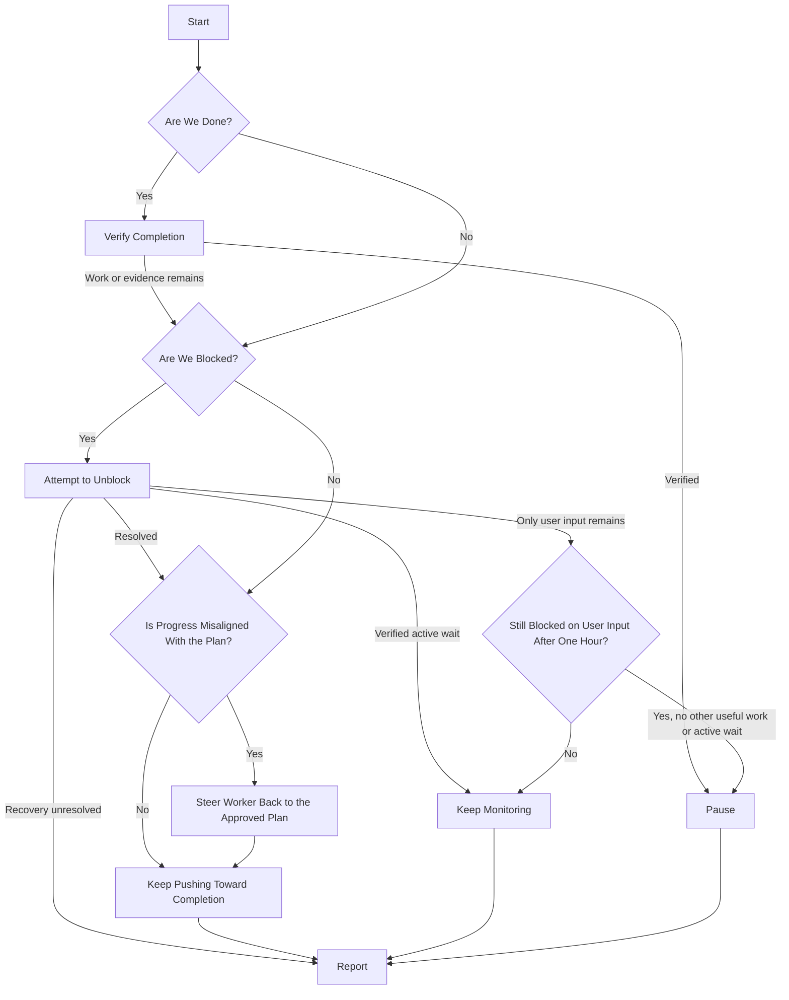

# Project Supervision

Keep approved work moving toward the project's outcome while this supervisor chat
stays available for the user's decisions and steering. Delegate lengthy discovery,
preparation and implementation to standalone worker chats, not subagents replacing
those chats. Each invocation acts, reports and yields.

## Flow

Start is one invocation by the user or the existing automation. Explicit stop
instructions override the flow immediately.



### Start

- A human invocation adopts this supervisor chat and authorizes ordinary setup,
  worker selection and scoped dispatch/steering. Resolve project, repository and
  user direction; clarify ambiguity. Stale ticks cannot adopt supervision or
  resume paused/stopped work.
- Apply stops before audits or Linear access. A project stop ceases dispatch and
  covers every owned worker/helper unless lane-scoped. Stop affected execution and
  pause the heartbeat through supported controls; inspect and report running/unknown
  work. Pausing does not prove settlement.
- Otherwise recover contract, tickets, PRs and roster from this chat/current sources.
  Inspect every recorded worker with compact snapshots and targeted output for
  progress, drift, stalls, idle or unknown execution. Resolve missing reports and
  uncertain ownership before overlap. Attempt authorized unblocks for each blocked or
  stalled lane and prepare exact human requests even while others progress. Global
  blockage controls project-wide waiting/pausing, not attention to individual lanes.
- Establish readiness through [project-audit](../project-audit/SKILL.md) before
  activation/resume, worker creation or dispatch. Reuse completed applicable coverage
  under one hour old if current Linear/PR deltas support it; refresh at one hour or
  after an earlier consequential change. Chat silence is insufficient. Record completion time,
  verdict and coverage. Failed/incomplete coverage holds affected new dispatch without
  refreshing its timestamp; completed coverage may support independent ready work.
  Age or failed refresh alone does not interrupt still-supported active work.
  For lengthy cold-start audits, complete limited readiness for read-only audit or
  preparation: verify target, authority, ownership, deliverable and supported isolated
  setup before creation, actual worktree before repository dispatch. Delegate only
  that scope; implementation needs its own completed current assessment. Limited
  preparation coverage neither verifies broader readiness nor refreshes a full audit.
- Assess apparent completion against approved criteria. A finished batch, Done status
  or merged PR is insufficient. Challenge completion when warranted, not every tick.

Create, activate or resume the supervisor heartbeat only for eligible execution, scoped
preparation,
verified active waits or the user-input grace period. Reuse the supervisor heartbeat:
nominally every 15 minutes, `kind=heartbeat`, exact prompt `$project-supervise`, bound to
this chat; workers have no automation. Completion needs no new automation. The user-input
grace period permits monitoring, not unready execution. Run the first cycle immediately.
Verify binding/state, preserve
partial setup and inspect uncertain results before retrying. Pause known superseded
heartbeats without exhaustive history searches; stale ticks cannot reclaim ownership.

### Verify Completion

1. Map approved goals/phase exits to evidence. Inspect the combined merged revision,
   affected consumers, interfaces, runtime/configuration and maintained instructions.
   For removals, check obsolete reachable behavior/instructions; legitimate history
   may remain.
2. Have an authorized non-author independently seek counterexamples in primary evidence. The
   supervisor qualifies if independent of authoring; otherwise use an authorized
   assessor within existing limits. Challenge the combined outcome, not every PR.
3. Verify consequential corrections. Disposition findings: corrected, retained with
   purpose/authority, outside scope with rationale, or unresolved/unverified.
   Required gaps prevent completion; missing scope/protected changes need the user's
   exact decision. Reuse valid challenge evidence until material changes or contradictions
   invalidate it.
4. Preserve required deployment, operational proof and designated human acceptance.
   Once satisfied, pause and Report criteria evidence, revision, assessor/coverage,
   findings and remaining nonblocking obligations. Otherwise route remaining gaps
   through the flow.

This adds no blanket acceptance gate or Linear authority. Summarize here without
an automatic publication question. If reported completion proves false, identify
reconciliation/reopening; change records only with scoped user authority.

### Attempt to Unblock

- The project is blocked only when no useful independent work can proceed. Test early-stop
  claims against the next plausible approved ticket. Distinguish required merged or deployed
  behavior from prerequisite source permitting authoring under stacking rules.
- Resolve routine blockers within authority. Delegate substantial approved discovery or
  read-only preparation; it authorizes no dependent implementation or amendment.
  Hold affected paths while independent ready work continues.
- For user-only blockers, present the actionable request in Report and retain its
  first timestamp for the one-hour wait. Unfinished agent preparation is not a user approval
  request.
- Monitor identified active owners/processes or concrete pending events. An assignee
  or Todo/Backlog status alone establishes no active wait.
- If recovery remains unresolved with no useful human intervention or verified active wait,
  report recovery owner/action and uncertainty. Preserve authorized supervision
  without inventing a wait or approval request.

### Steer Worker Back to the Approved Plan

Compare actual progress and artifacts with ticket criteria and project contract. Send
in-scope draft corrections through supported messaging, inspect their evidence and retain
the original deadline.
After readiness, report issues for the queue or user to handle without competing changes.
Keep necessary amendments as proposals in Report with reasoning, impact and exact
approval requested; continue independent work.

### Keep Pushing Toward Completion

- Default to one active assignment; higher caps need user approval. Active/unknown
  execution occupies capacity until settled. Reductions drain batches unless
  interruption is requested. Fill eligible idle slots without repeated permission
  after prior execution and helpers settle.
- Assign distinct ordered shortlists, normally five tickets, exceeding expected
  batch capacity when available. Respect priorities, dependencies, ownership and
  milestone review gates. Present gate evidence and await required plan/execution
  approval; phase completion grants none.
- Check entire shortlists for collisions: shared semantic/test regions, queue-owned
  pending changes and runtime resources. Barrels, generated metadata, mocks and
  fixtures need one owner or serialized edits. Separate worktrees alone do not prove
  independence. Hold only collisions.
- Bind stable roster slots to chat IDs. Titles are labels: `WORKER: <supervisor title>`
  for one, or `WORKER 1: <supervisor title>`, etc. Inspect recorded IDs first; reuse
  verified compatible unbound workers or create eligible missing slots. Preserve
  active batches, deadlines and concurrent work. Resolve ownership ambiguity rather than
  selecting by title recency.
- Verify dedicated managed Git worktrees before repository work. Before creation,
  verify native inventory `isGitRepository=true`; use `create_thread` with its
  `projectId`, `environment: {type: "worktree"}`, preserved model/thinking and no
  starting-state override unless requested. For compatible Local workers, use
  `handoff_thread`, inspect `get_handoff_status` and verify returned chat ID, repository and
  worktree before dispatch. Hold unverified isolation; preserve partial setup and
  read back uncertain outcomes before retrying.
- Read [the worker contract](references/worker.md) and assignment checklist before
  first assignment; reuse current context unless changed/uncertain. Every assignment
  supplies its resolved absolute path and explicitly directs the worker to read and follow it.
  Batches normally last 50 minutes including cleanup/reporting. Refresh exhausted or
  materially changed shortlists.
- Activate the Start heartbeat setup before dispatch; verify heartbeat/dispatch state
  before yielding with active work. Report and yield; reserve bounded immediate waits
  for uncertain dispatch, required handoffs or problems unsafe to defer. Keep the
  supervisor available while workers execute. After authoring, prepare the next
  handoff's owner, action, evidence and needed approval. Dispatch only useful work;
  create no workers merely to wait.

### Keep Monitoring

Start each user-only blocker's clock at its first actionable Report request; recover
that timestamp later. Monitor until unresolved for over one hour. Repeats, partial
or unrelated answers do not reset unresolved asks; sufficient answers resolve them.
Continue independent work and verified active waits regardless of this timer.

Monitor verified processes that can unblock work; investigate stalls. Do not pause solely
because checks remain unchanged. Monitoring handoffs need an identified owner and
verified supported resolution-detection mechanism.

### Pause

Pause and verify the heartbeat for verified completion, explicit project stop, or
user-only blockage over one hour when no useful work can proceed and no verified
active wait remains. Stops
apply immediately. Other blockers require recovery and an owner/action report, not
invented waits.

Record the reason and resume condition. A sufficient answer permits blocker-paused resumption
once ready; explicit stops require later human resume/invocation. Written conditions
provide no wakeup: explain when the user must return here or authorize an answer
relay from another chat.

### Report

End every invocation with a self-contained report here, including unchanged, blocked,
stopped and unverifiable runs. Distinguish authored, merged, deployed and accepted
work. Retain unresolved requests until evidence resolves them; uncertainty stays unknown.
Then yield.

```markdown
### Summary

[Two to four concise sentences: progress, plan alignment, execution assessment,
and a grounded improvement recommendation or why no change is warranted.]

### Planning Proposals

- **PLAN CHANGE PROPOSAL — [Change]:** [Current plan → exact amendment; reasoning;
  material delivery/validation impact; exact user approval requested; affected links.]

### Blockers

- [Human decision, permission or intervention; recommendation, affected work and
  what the answer unblocks. For user-only waits, include first-request time and
  the next check or pause state. Refer to a planning proposal by name.]

### Next Steps

- [Owner — next authorized action/result, or wait and resume condition.]

### Other

- [Material outcome/risk, evidence/validation limits, recovery or control details.]
```

Keep Summary, Blockers (**None** if empty) and Next Steps; omit empty optional sections.
Questions need reasoning/impact; amendment approvals must say **PLAN CHANGE** and name
the amendment. Operational permissions belong in Blockers unless amending the plan.
Keep unapproved proposals separate from execution commitments. Agent/queue problems and
routine merge/risk
holds are not human blockers: own resolution in Next Steps or explain delivery impact in Other.
Report only grounded concerns and recommendations.

Retain the full report in the supported heartbeat response, respecting its quiet
envelope and saved notification preferences. Notify on meaningful changes, actionable
requests, failures or completion; retain unchanged asks without redundant notifications.
Disclose unavailable delivery/missing output. Interruption may prevent reporting;
inspect unknown execution next cycle rather than claiming settlement.

## Rules

- The user owns the plan. Follow the [plan and state permissions](../project-audit/references/project-contract.md#plan-and-state-permissions)
  and [supervised Linear write gate](../../AGENTS.md#linear-writes-during-supervised-implementation).
  Generic supervision grants no manual ticket/project edits, comments or posts.
  Relay actual user authority with its source and scope; reuse exact approvals.
  Verify authorized writes and recover uncertain outcomes before retrying.
- Follow [PR ownership](../../AGENTS.md#pr-delivery-ownership-in-project-workflows):
  workers author/validate/ready drafts; the queue owns ready PRs. The supervisor
  steers and evaluates alignment without editing PRs or taking over their pipeline.
- Execution stays within approved tickets and scoped preparation. Missing scope
  needs a proposal. Deployment, production mutations, operational acceptance,
  explicit-only skills and external communications retain their owning permissions.
  Authorized project posts follow the [status update policy](../../AGENTS.md#project-status-updates).
- Use actual supported tools and controls. A denial is not an invitation to change
  transports. Report unsupported stop/pause actions and running/unknown work; do not
  invent continuation, cancellation, notification or timing guarantees.
- Keep roster, cap, assignments/ownership, worktrees, PRs, deadlines, audit coverage,
  pending-request times, next checks and pause/stop state in chat/native records.
  Linear holds the approved plan and durable work evidence. Keep no local registry,
  memory, marker or project-management mirror; leave legacy coordination documents
  unchanged. Do not delete automations or archive chats as routine cleanup.
