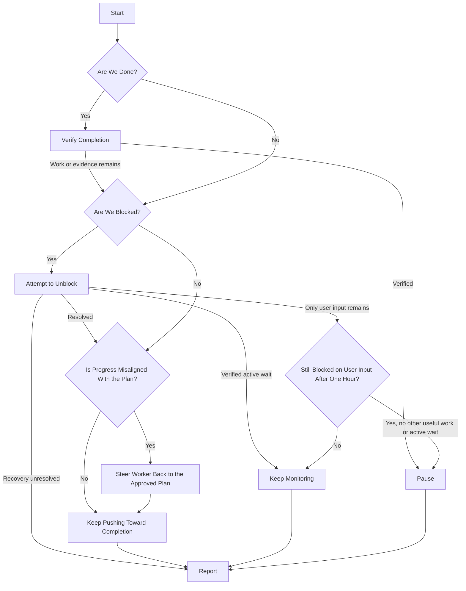

# Project Supervision

Keep approved work moving toward the project's outcome while this supervisor chat
stays available for the user's decisions and steering. Delegate lengthy discovery,
preparation and implementation to standalone worker chats, not subagents replacing
those chats. Each invocation acts, reports and yields.

## Flow

Start is one invocation by the user or the existing automation. Explicit stop
instructions override the flow immediately.



### Start

- An explicit human invocation adopts this chat as supervisor and authorizes
  ordinary setup, worker selection and scoped dispatch/steering. Resolve the
  project, repository and current user direction; clarify genuine ambiguity.
  A stale scheduled invocation cannot adopt supervision or resume paused/stopped work.
- Apply a stop before auditing or requiring Linear access. A project stop ceases
  dispatch and applies to every owned worker/helper unless scoped to a lane.
  Use supported controls to stop affected execution and pause the project heartbeat;
  inspect results and report running or unknown work. Pausing never proves settlement.
- Otherwise recover the approved contract, tickets, PRs and roster from this chat
  and current sources. Inspect all recorded workers using compact status snapshots
  and targeted output; distinguish useful progress, drift, stalls, idle and unknown
  execution. Missing reports or uncertain ownership need resolution before overlap.
- Establish readiness through [project-audit](../project-audit/SKILL.md) before
  activation/resume, worker creation or dispatch. Reuse applicable completed coverage
  less than one hour old when current evidence supports it; refresh at one hour or
  sooner after consequential changes. Check current Linear/PR deltas, not silence
  in chat. Keep completed time, verdict and coverage in chat/native records.
  Failed or incomplete coverage holds affected new dispatch and does not refresh
  its timestamp; completed coverage can support independent ready work. Age or a
  failed refresh alone does not interrupt useful, still-supported active work.
- Use the approved criteria to ask whether the outcome appears complete. A finished
  batch, Done status or merged PR alone is insufficient. Perform the completion
  challenge only when warranted, rather than on every heartbeat.

Create, activate or resume a heartbeat only for eligible execution, scoped
preparation, a verified active wait, or the user-input grace period below. Reuse
the existing supervisor heartbeat: nominally every 15 minutes, `kind=heartbeat`,
prompt exactly `$project-supervise`, bound to this chat; workers have no automation.
Verified completion requires no new automation. The grace period authorizes
monitoring, not otherwise unready execution. Run the first cycle immediately. Verify binding/state; retain partial setup and inspect
uncertain results before retrying. Pause a known superseded heartbeat, without an
exhaustive historical search or allowing stale ticks to reclaim ownership.

### Verify Completion

1. Map approved goals and phase exits to evidence. Inspect the combined merged
   revision and affected consumers, interfaces, runtime/configuration paths and
   maintained instructions as relevant. For removals, check obsolete reachable
   behavior and operating instructions; legitimate history may remain.
2. Have an authorized non-author independently seek counterexamples in primary
   evidence. The supervisor may fulfill this role if independent of authoring;
   otherwise use an appropriate authorized assessor within existing limits.
   This is one combined-outcome challenge, not another review of every PR.
3. Verify consequential corrections. Disposition findings as corrected, retained
   with purpose/authority, outside scope with rationale, or unresolved/unverified.
   Required gaps prevent completion; missing scope or protected changes need the
   user's exact decision. Reuse valid challenge evidence until material changes
   or new contradictions invalidate it.
4. Preserve required deployment, operational proof and designated human acceptance.
   If satisfied, pause and summarize completion in Report with criteria evidence,
   assessed revision, assessor/coverage, findings and remaining nonblocking obligations.
   Otherwise route the remaining work or evidence gap through the rest of the flow.

Completion assessment adds no new blanket acceptance gate or Linear write authority.
The summary belongs in this chat; it does not automatically prompt a request to
publish it. If a previously reported completion proves false, identify required
reconciliation/reopening and apply record changes only with scoped user authority.

### Attempt to Unblock

- Treat the project as blocked only when no useful independent work can proceed.
  Verify early-stop claims against the next plausible approved ticket. Distinguish
  a required merged/deployed behavior from prerequisite source that permits authoring
  under the repository's stacking rules.
- Investigate and resolve routine blockers within existing authority. Delegate
  substantial approved discovery or read-only preparation needed for a decision;
  preparation does not authorize dependent implementation or a plan amendment.
  Continue independent ready work while holding only affected paths.
- If only the user can unblock progress, retain the first actionable request's
  timestamp and use the one-hour wait below. Prepare and present the actual request
  in Report. Agent preparation still owed is not a user approval request.
- An identified active owner/process or concrete pending event leads to Keep
  Monitoring. An assignee or Todo/Backlog status alone does not establish an active wait.
- If bounded recovery remains unresolved without useful human intervention or a
  verified active wait, report the recovery owner/action and uncertainty. Preserve
  existing authorized supervision without inventing a wait or human approval request.

### Steer Worker Back to the Approved Plan

Compare actual progress and artifacts with ticket criteria and the project contract.
Steer in-scope corrections through supported messaging while the worker's PR is a
draft, then inspect correction evidence; retain its original batch deadline.
After readiness, report issues for the queue or user instead of pushing competing
changes. Keep the approved plan intact. Put any necessary amendment and its reasoning,
impact and exact approval request in Report while independent work continues.

### Keep Pushing Toward Completion

- Default to one active worker assignment; a user may approve a higher cap. Active
  or uncertain execution occupies capacity until settled. A reduced cap drains
  existing batches unless interruption is requested. Fill eligible idle slots
  without repeated permission, after prior owned execution and helpers settle.
- Give each worker a distinct ordered shortlist, normally five tickets, with more
  than expected batch capacity when available. Respect priorities, dependencies,
  ownership and explicit milestone review gates. At such a gate, present evidence
  and await the required plan/execution approval; phase completion alone grants none.
- Check whole-shortlist collisions, including later tickets, shared semantic/test
  regions, pending queue-owned changes and runtime resources. Shared barrels,
  generated metadata, mocks and fixtures need one owner or serialized edits;
  separate worktrees alone do not establish independence. Hold only collisions.
- Bind stable roster slots to chat IDs. Titles are labels: `WORKER: <supervisor title>`
  for one, or `WORKER 1: <supervisor title>`, `WORKER 2: <supervisor title>`, etc.
  Inspect recorded IDs first. Reuse verified compatible unbound workers or create
  an eligible missing slot; preserve active batches, deadlines and concurrent work.
  Resolve ambiguous ownership rather than adopting by title recency.
- Before repository work, verify a dedicated managed Git worktree. For creation,
  verify `isGitRepository=true` in the native project inventory and use `create_thread`
  with that `projectId` and `environment: {type: "worktree"}`. Preserve model/thinking
  and omit starting-state overrides unless requested. Move a compatible Local worker
  through `handoff_thread`, inspect `get_handoff_status`, and verify the returned
  chat ID/repository/worktree before dispatch. Hold if isolation is unverified;
  preserve partial setup and read back uncertain outcomes before retrying.
- Use [the worker contract](references/worker.md) and its assignment checklist.
  Read it before first assignment, then reuse current context unless changed or
  uncertain. Every assignment must supply its resolved absolute path and explicitly
  instruct the worker to read and follow it. Batches normally last 50 minutes including
  cleanup/reporting; refresh exhausted or materially changed shortlists.
- Ensure the Start heartbeat setup is active before dispatch; before yielding with
  active work, verify heartbeat and dispatch state. Report and yield. Reserve bounded
  immediate waits for uncertain dispatch, required handoffs or concrete problems
  that cannot safely wait
  for the next check. Do not occupy the supervisor merely watching useful work.
  When authoring ends, prepare the concrete next handoff: owner, action, evidence and
  any needed approval. Do not fill capacity with invented work or waiting workers.

### Keep Monitoring


For user-only blockers, start the clock with the first clear actionable request in
Report and recover its original timestamp on later invocations. Keep monitoring
until it has remained unresolved for over one hour; repeated reports and unrelated
messages do not reset the clock. A sufficient answer resolves the request. Continue
any independent work and retain verified active waits regardless of this timer.

Monitor verified active processes while they can unblock work. Investigate stalls;
unchanged-check counts alone do not justify pausing. A monitoring handoff requires
an identified owner and verified supported mechanism to detect resolution.

### Pause

Pause and verify the heartbeat after verified completion, an explicit project stop,
or a user-only blocker unresolved for over one hour when no useful work or verified
active wait remains. A stop takes effect immediately. If blocked for another reason,
attempt recovery and report its owner/action; do not manufacture an active wait.

Record the reason and resume condition. A sufficient human answer permits resuming
a blocker-paused heartbeat once readiness supports it; an explicit stop needs later
human resume/invocation. A written condition is not a wakeup mechanism: explain when
the user must return here or explicitly authorize an answer relay from another chat.

### Report

Every invocation ends with a self-contained own-chat report, including unchanged,
blocked, stopped and unverifiable runs. Distinguish authored, merged, deployed and
accepted work. Keep important unresolved requests visible until evidence establishes
resolution; mark uncertain resolution unknown. Then yield.

```markdown
### Summary

[Two to four concise sentences: progress, plan alignment, execution assessment,
and a grounded improvement recommendation or why no change is warranted.]

### Planning Proposals

- **PLAN CHANGE PROPOSAL — [Change]:** [Current plan → exact amendment; reasoning;
  material delivery/validation impact; exact user approval requested; affected links.]

### Blockers

- [Human decision, permission or intervention; recommendation, affected work and
  what the answer unblocks. For user-only waits, include first-request time and
  the next check or pause state. Refer to a planning proposal by name.]

### Next Steps

- [Owner — next authorized action/result, or wait and resume condition.]

### Other

- [Material outcome/risk, evidence/validation limits, recovery or control details.]
```

Keep Summary, Blockers and Next Steps; use **None** for an empty Blockers list.
Omit empty Planning Proposals and Other sections. Prepare questions before asking:
include reasoning and material impact. Approval questions about amendments must say
**PLAN CHANGE** and name them. Operational permissions belong in Blockers unless
they amend the plan; unapproved proposals are not execution commitments. Agent/queue
problems and routine merges/risk holds are not human blockers; own their resolution
in Next Steps or explain delivery impact in Other. Do not invent critique or proposals.

Keep the complete report in the host's supported heartbeat response while following
its required quiet envelope and saved notification preferences. Notify on meaningful
changes, actionable requests, failures or completion; unchanged pending requests stay
in the report without redundant notifications. Report unavailable delivery or missing
output honestly; interruption may prevent a report, so inspect unknown execution
next cycle rather than claim settlement.

## Rules

- The user owns the plan. Follow the [plan and state permissions](../project-audit/references/project-contract.md#plan-and-state-permissions)
  and [supervised Linear write gate](../../AGENTS.md#linear-writes-during-supervised-implementation).
  Generic supervision grants no manual ticket/project edits, comments or posts.
  Relay actual user authority with its source and scope; reuse exact approvals.
  Verify authorized writes and recover uncertain outcomes before retrying.
- Follow [PR ownership](../../AGENTS.md#pr-delivery-ownership-in-project-workflows):
  workers author/validate/ready drafts; the queue owns ready PRs. The supervisor
  steers and evaluates alignment without editing PRs or taking over their pipeline.
- Execution stays within approved tickets and scoped preparation. Missing scope
  needs a proposal. Deployment, production mutations, operational acceptance,
  explicit-only skills and external communications retain their owning permissions.
  Authorized project posts follow the [status update policy](../../AGENTS.md#project-status-updates).
- Use actual supported tools and controls. A denial is not an invitation to change
  transports. Report unsupported stop/pause actions and running/unknown work; do not
  invent continuation, cancellation, notification or timing guarantees.
- Keep roster, cap, assignments/ownership, worktrees, PRs, deadlines, audit coverage,
  pending-request times, next checks and pause/stop state in chat/native records.
  Linear holds the approved plan and durable work evidence. Keep no local registry,
  memory, marker or project-management mirror; leave legacy coordination documents
  unchanged. Do not delete automations or archive chats as routine cleanup.
